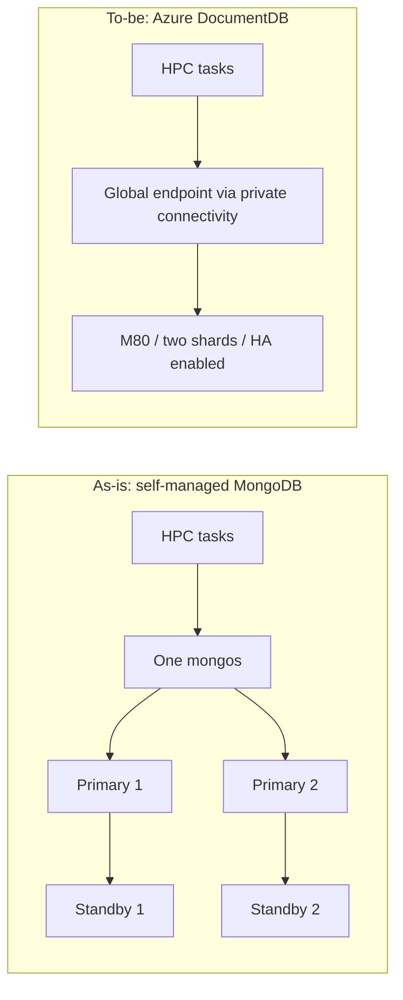

# MongoDB에서 Azure DocumentDB로: Caldova Securities의 HPC Workload 레퍼런스

High-performance computing(HPC)을 지원하는 데이터베이스는 query volume이 비교적 적어도 심각한 connection pressure를 겪을 수 있습니다. 수명이 짧은 task가 반복해서 client를 만들고, TLS를 negotiate하고, 인증한 뒤 연결을 끊으면 이 connection lifecycle 자체가 하나의 capacity requirement가 됩니다.

Caldova Securities는 안정성과 성능을 이유로 **Azure DocumentDB M80, shard 2개, high availability(HA) 활성화** 구성을 선택했습니다. 마이그레이션 전 기존 MongoDB 환경은 primary 2개, standby 2개, `mongos` router 1개의 총 5개 구성 요소로 이루어져 있었습니다.

이 글은 workload, 검증 방법, 테스트 결과에 영향을 준 구성 세부 사항, 그리고 다른 프로젝트에 적용할 수 있는 lessons learned을 설명합니다. Caldova Securities는 가명입니다.

*_최종 테스트 campaign은 2026-08-03에 수행했으며, 일부 결과는 2026-08-02와 2026-07-15의 이전 campaign에서 가져왔고 5절에 표시했습니다. 측정값은 테스트한 데이터베이스 접근 패턴에 대한 것이며, HPC 계산 엔진의 성능이나 마이그레이션 이후의 정량화된 availability 개선을 의미하지 않습니다._

## 핵심 요약

- Production task rate(약 135 tasks/s, task당 4개 operation, task마다 새 client)에서 DocumentDB M80(shard 2개)과 MongoDB(router 4개)는 모두 부하를 처리했습니다. DocumentDB는 median latency가 더 낮았고, MongoDB는 tail이 더 안정적이었습니다.
- Task rate와 connection pressure는 별개의 요구 사항입니다. 약 11,000개의 대부분 idle 상태인 connection은 11,000개의 active workload를 의미하지 않습니다.
- 두 대상 모두 12,000개의 held connection에 도달했지만 이는 설정된 상한(ceiling)이었습니다. M80은 평균 4,476개의 Ready connection(MongoDB router 4개는 10,570개)을 유지했고, 10,000개를 초과한 iteration은 3회 중 2회(MongoDB는 3회 중 3회)였습니다.
- 선택된 shard 2개 M80은 production burst rate인 약 1,210 connections/s에서는 테스트하지 않았습니다. Overload 결과는 saturation을 보여줄 뿐, 운영에서 허용 가능한 동작이 아닙니다.
- 비용 절감, availability 개선, failover 동작은 측정하지 않았습니다.

## 1. 기존 Workload를 요구 사항으로 변환하기

데이터베이스는 계산 입력을 제공하고 task 결과를 저장했습니다. Task의 lifecycle은 다음과 같습니다.

```text
Create fresh client -> find input -> calculate -> delete previous output
                    -> insert result -> find result -> release resources
```

4개의 데이터베이스 operation(read 2회, delete 1회, insert 1회)은 필수였습니다. Delete와 insert를 upsert로 바꾸면 workload를 재현하는 것이 아니라 변경하는 것이 됩니다. Operation은 논리적 request identifier인 `ReqId`를 사용했습니다.

아키텍처 변경은 다음과 같이 요약됩니다.



이 그림은 논리 구성도이며, 완전한 replica-set 또는 config-server 배포 사양이 아닙니다. 또한 기존의 router 1개 아키텍처는 벤치마크에서 사용한 **MongoDB router 2개 및 4개 구성**과 구분해야 합니다.

Production telemetry에서는 서로 다른 두 가지 차원이 확인되었습니다.

| 차원 | 테스트에 사용한 요구 사항 | 의미 |
|---|---|---|
| Task processing | 약 135 tasks/s, task당 데이터베이스 operation 4개 | 계산 입력/출력 사이클의 지속적인 처리 |
| Connection pressure | 약 1,210 new connections/s의 burst, 대부분 idle 상태인 약 11,000개의 live connection | Connection의 생성과 누적이며, 11,000개의 동시 active query가 아님 |

이 두 peak는 동시에 발생하지 않았습니다. 기록된 connection peak 시점의 operation volume은 초당 약 5개에 불과했습니다. 또한 production에서는 driver topology-monitoring connection을 포함해 논리적 task당 여러 개의 물리적 connection이 사용되었습니다. 따라서 task arrival rate와 socket creation rate는 서로 바꿔 쓸 수 없습니다.

Connection lifetime은 operation이 적은 workload에서도 많은 connection이 누적되는 이유를 설명합니다. 근사적으로, 초당 1,210개의 새 connection이 약 9초간 유지되면 live connection은 약 10,890개가 됩니다. Throughput만 보는 벤치마크로는 이 요구 사항을 놓치게 됩니다.

## 2. DocumentDB와 Access Path 구성하기

선택한 아키텍처는 M80, shard 2개, HA 활성화였습니다. 직접 수행하는 campaign에서도 storage 할당, region, network path, HA 상태를 기록하세요.

| | Azure DocumentDB | MongoDB, Router 4개 |
|---|---|---|
| Compute | shard당 M80: 32 vCore / 128 GiB RAM, shard 2개 | shard VM 2대(각 24 vCore, `mongos` 겸용) + 8 vCore router VM 2대 |
| 버전 및 network | Managed service, private endpoint | MongoDB 7.0, private network, self-signed CA |
| Standby 및 failover | HA 활성화, failover는 테스트하지 않음 | Standby 동작은 테스트하지 않음 |
| Load generator | 1대(normal load), 3대(hold 및 overload) | 동일 |

테스트한 다른 DocumentDB tier는 M60(shard당 16 vCore / 64 GiB)과 M200(shard당 64 vCore / 256 GiB)입니다. Tier별 크기는 [Microsoft Learn](https://learn.microsoft.com/en-us/azure/documentdb/compute-storage)을 참고하세요.

### Endpoint, Networking, Authentication

서비스가 제공하는 global endpoint와 SRV discovery를 특정 backend host에 pinning하지 않고 그대로 사용하세요. 민감 정보를 제거한 URI 형식은 다음과 같습니다.

```text
mongodb+srv://<user>:<encoded-password>@<cluster>.global.mongocluster.cosmos.azure.com/<database>?tls=true&authMechanism=SCRAM-SHA-256&retrywrites=true
```

서비스가 제공하는 connection string으로 시작하고 필수 옵션은 그대로 유지하세요. 위 예시는 endpoint와 인증 방식을 보여주기 위한 것이며, 클러스터별 connection string을 대체하지 않습니다.

참조 환경은 private connectivity를 사용했습니다. 각 generator VNet에는 private endpoint로의 연결과 `privatelink.mongocluster.cosmos.azure.com`에 대한 적절한 link가 필요했습니다. Seed hostname과 SRV target hostname이 모두 private으로 resolve되는지 확인한 다음 TCP reachability를 확인하세요. Resolve된 backend IP를 애플리케이션에 hard-code하지 마세요.

`.global` hostname은 access path에 관한 세부 사항일 뿐이며, cross-region disaster recovery가 구성되었거나 테스트되었다는 증거가 아닙니다.

### Data Distribution과 Driver 설정

| 설정 | 참조 동작 |
|---|---|
| Dataset | seed 42로 생성한 입력 document 100,000개 |
| Document 크기 | 6 KiB: 10,000개, 16 KiB: 15,000개, 50 KiB: 35,000개, 58 KiB: 40,000개 |
| Operation key | 입력 및 출력 collection의 indexed `ReqId` |
| Distributed shard key | shard 2개 테스트에서 hashed `ReqId` |
| Software | .NET 8, MongoDB C# driver 2.30 |
| Task별 client | 새 client와 settings, `maxPoolSize=1`, `minPoolSize=0`, task 간 재사용 없음 |
| Timeout | Server selection과 connect 각 5,000 ms, socket timeout 없음 |
| Retryable writes | 벤치마크 factory가 DocumentDB에 대해 강제로 활성화 |

Shard가 provisioning되었다는 사실만으로는 데이터가 분산되었다는 증거가 되지 않습니다. 이전에 single-shard로 설명된 실행은 물리 shard가 2개 provisioning되어 있었음에도 데이터가 한 shard에 몰려 있었습니다. 분산 테스트에서는 collection을 비어 있는 상태에서 shard한 뒤 데이터를 다시 seed했으며, chunk metadata와 query explain 출력으로 분산을 확인했습니다. 이는 이 사례에서 사용한 절차이며, 모든 기존 dataset을 다시 구축해야 한다는 의미는 아닙니다.

설정 파일은 `Extends`로 상속되고 코드가 URI 설정을 override할 수 있습니다. 최종 DocumentDB client는 URI와 무관하게 retryable writes를 강제로 켭니다. 재현하려면 connection string만이 아니라 **effective configuration**이 필요합니다.

## 3. Generator가 Bottleneck이 되지 않도록 하기

Connection churn은 데이터베이스뿐 아니라 client host에도 부하를 줍니다. 이 generator 관련 내용은 DocumentDB에 국한되지 않으므로 요약만 제시하며, 자세한 내용은 repository에 있습니다.

### TCP Capacity와 Arrival Budget

Windows generator는 dynamic TCP port range를 **10000-65534**로, **`TcpTimedWaitDelay=30 s`**로 조정했습니다. 모든 generator에 적용한 뒤 reboot하고 확인했습니다.

55,535개의 port를 30초로 나누면 TIME_WAIT만 고려한 budget은 host당 약 **1,851 connections/s**입니다. 이는 sizing 추정치일 뿐 보장된 throughput이 아니며, CPU와 handle도 영향을 줍니다.

3-host overload 구성은 host당 초당 4개의 Poisson job arrival과 job당 150-500개 task를 사용했고, 예상 offered rate는 host당 약 1,300 tasks/s(합계 3,900)로 위 budget 이내였습니다. 상속받은 multi-host base(초당 6개 job, host당 약 1,950 tasks/s)는 이 budget을 초과했을 것입니다.

설정한 offered rate는 측정된 connection rate가 아닙니다. Arrival counter, connection attempt, Ready event, completion을 각각 확인하세요.

권한이 있는 전용 테스트 host에서는 [repository의 TCP tuning script](../scripts/setup/tune-vm1.ps1)를 사용하세요. OS network 변경은 검토가 필요하며 production machine에 무분별하게 적용해서는 안 됩니다.

### Client Runtime과 Lifecycle 제어

| 실패 위험 | 벤치마크에서 한 일 | Production 시사점 |
|---|---|---|
| 느린 실패의 누적 | 5초 connect 및 server-selection timeout 적용 | Task 전체 deadline과 제한된 retry budget을 추가하세요. Connection timeout만으로는 모든 operation이 제한되지 않습니다 |
| ThreadPool starvation | 지속 부하 중 incident(DB는 idle인데 client latency 상승) 이후 `ThreadPool.SetMinThreads(512, 512)` 설정 | 먼저 queueing, thread, CPU, handle을 측정하세요. 512는 범용 권장값이 아닙니다 |
| Topology-monitor 증가 | 자체 관리 MongoDB의 task를 `directConnection=true`로 router 1개에 round-robin pinning | MongoDB를 위한 벤치마크용 access-path 최적화이며 일반적인 HA discovery 패턴이 아닙니다. DocumentDB는 pinning 없이 global endpoint를 사용했습니다 |
| Task보다 오래 남는 cluster 리소스 | 각 cluster를 명시적으로 unregister 및 dispose | Driver 내부 API를 사용하므로 driver 버전을 고정하고 업그레이드 시 cleanup을 다시 테스트하세요 |

Driver는 여전히 내부 pool 객체를 생성했습니다. 제약 조건은 **task 간 재사용 금지**였습니다. 벤치마크의 teardown과 lifecycle event는 테스트 계약의 일부였습니다.

### TLS 설정은 반드시 공개해야 합니다

구현 기록에 따르면 동시 certificate-revocation check 때문에 40-way concurrency에서 handshake가 약 29.5초 걸렸고, 순차 실행에서는 100 ms 미만이었습니다. Factory는 `CheckCertificateRevocation=false`로 revocation check를 비활성화했습니다.

별도로, 자체 관리 MongoDB의 normal-load 및 hold 구성에서는 `MongoAllowInsecureTls`를 활성화하여 private-CA router의 certificate 검증을 완화했습니다. 이 둘은 서로 다른 보안 변경입니다. Revocation check를 끄는 것은 chain/hostname 검증을 우회하는 것과 다릅니다.

두 설정 모두 비교 조건에 영향을 줍니다. 어느 쪽도 조용히 production에 복사해서는 안 됩니다. 신뢰할 수 있는 certificate를 사용하고, certificate 및 revocation 경로의 connectivity를 계획하며, 보안 검토를 받으세요. Managed 대상의 chain/hostname 검증은 유지했지만, 벤치마크에서 revocation check는 여전히 비활성화되어 있었습니다.

### Server Limit, Backpressure, Recovery

자체 관리 MongoDB에서 connection limit을 올리는 것은 설정된 상한을 없앨 뿐 TLS/authentication CPU 용량을 만들어 주지는 않습니다. Router 2개 구성은 VM CPU가 saturation되었지만 router 4개 구성은 그렇지 않았습니다(5절).

Open-loop 테스트는 의도적으로 `MaxConcurrentTasks`를 우회했습니다. Backend가 느려질 때 누적이 발생하는 모습을 드러냈지만, overload에 안전한 애플리케이션 설계는 아니었습니다. Production에서는 제한된 queue/concurrency, rate limit, backpressure, 그리고 장애 중인 의존 대상을 악화시키지 않는 retry를 사용하세요. 결합된 트래픽을 명시적으로 의도한 경우가 아니라면 한 번에 하나의 arrival scenario만 활성화하세요.

테스트 사이에는 Ready connection과 처리 중인 작업이 drain되고, CPU가 회복되고, TIME_WAIT 압력이 줄어드는지 확인하세요. 벤치마크는 TIME_WAIT 수가 대략 200 미만인 것을 준비 상태 확인 기준으로 사용했습니다. 기록된 M200 throttling 사례는 약 8분 후 회복되었는데, 이는 관찰 결과일 뿐 문서화된 cooldown 보장이 아닙니다.

## 4. 서로 다른 질문에는 별도의 테스트를

벤치마크는 대상 간에 동일한 deterministic dataset과 operation semantics를 사용했으며, data cache warm-up은 측정 대상에서 제외했습니다. 측정 중 connection은 항상 새것이었습니다. 즉 **데이터가 warm하다고 해서 재사용 가능한 connection이 warm한 것은 아니었습니다**.

| 시나리오 | 모델 | 질문 |
|---|---|---|
| Normal processing | Closed-loop, 4개 operation 전체 workload, 약 135 tasks/s | 플랫폼이 안정적인 latency로 task workload를 처리할 수 있는가? |
| Production-rate connection pressure | 약 1,210 connections/s의 2-host open-loop campaign | Production과 유사한 rate에서 connection은 어떻게 누적되는가? |
| Deliberate overload | 예상 offered rate 약 3,900 tasks/s의 3-host open-loop 구성 | Backlog, latency, 실패는 어디서 나타나는가? |
| Connection holding | host 3대, host당 4,000개 gated task, 합계 12,000 상한 | 몇 개의 established connection을 유지할 수 있는가? |
| Operation baseline | 새 client당 indexed find 또는 insert 1회 | Non-saturating 부하에서 개별 operation의 latency는 얼마인가? |

최종 normal-load 비교는 generator 1대, 300초 iteration 3회, 계산용 sleep 없이 수행했으므로 각 connection의 수명은 production의 약 9초가 아니라 수 ms였습니다. Overload 구성은 task 대기 2,900 ms를 사용했습니다. 3-host hold 테스트는 300초 window를 사용했고, 유지 중인 connection마다 10초에 한 번 keepalive 입력 read를 수행했습니다. Production-rate campaign은 이전에 수행되어 timing과 코드 이력이 달랐습니다. 모든 테스트를 동일한 하나의 실험처럼 설명하지 말고 이러한 차이를 기록하세요.

두 가지 fidelity 한계가 있습니다.

- **Hold:** 12,000개 connection에서 keepalive 스케줄은 초당 약 1,200회의 read를 만들 수 있으며, 이는 production의 connection peak 시점 초당 약 5개 operation과 차이가 큽니다. 이 테스트는 connection holding을 근사할 뿐 production 부하를 재현하지 않습니다.
- **Open-loop:** 모든 connection이 4개 operation 전체 사이클을 수행했지만, production의 추가 connection은 대부분 operation이 거의 없는 driver monitoring이었습니다. 따라서 connection peak 시점의 데이터베이스 작업량이 과대 반영됩니다.

벤치마크에는 pass/fail 기준이 정의되어 있지 않았습니다. Production sizing 전에 합격 기준(acceptance criteria)을 정하세요. 예: error rate 한도, task deadline 이내의 p99, window 전체에 걸쳐 유지되는 connection 수, overload 이후 baseline으로의 recovery.

대상은 순차적으로 실행했습니다. 이후의 multi-host campaign은 두 대상에 동일한 generator pool을 사용했고, iteration마다 공통 시작 시각을 사용했습니다. Coordinator는 drain을 포함해 모든 host가 끝나기를 기다렸고, merge에는 전체 host 집합이 필요했습니다. Host가 누락되었거나 호환되지 않는 iteration은 유효한 결합 결과로 인정되지 않았습니다.

### 최소 재현 워크플로

1. Private connectivity를 provisioning하고 대상/generator topology, VM 크기, software revision, effective settings를 기록합니다.
2. Connection secret을 repository 밖에 설정하고, 각 generator를 tuning하고, DNS/TCP connectivity를 확인합니다.
3. 데이터를 seed하고 index를 생성한 뒤 물리적 분산을 확인합니다.
4. 측정 iteration 전마다 preflight와 측정 대상이 아닌 warm-up을 수행합니다.
5. 한 번에 하나의 대상에 대해 하나의 시나리오만 실행하고, multi-host iteration은 동기화합니다.
6. Output을 drain 및 정리하고, 대응하는 host artifact를 merge하며, 원시 metric과 resource telemetry를 보관합니다.

예를 들어 다음 repository 명령은 DocumentDB에 대한 single-host normal-load 시나리오를 준비하고 실행합니다.

```powershell
dotnet build Bmt.sln -c Release
dotnet run --project src/Bmt.Seeder -- prepare-data --config config/production/full-workload-closed-loop-steady.json --target documentdb
dotnet run --project src/Bmt.Preflight -- preflight --config config/production/full-workload-closed-loop-steady.json --target documentdb --warmup
dotnet run --project src/Bmt.LoadGen -- test --config config/production/full-workload-closed-loop-steady.json --target documentdb --scenario steady
dotnet run --project src/Bmt.Seeder -- clean-output --config config/production/full-workload-closed-loop-steady.json --target documentdb
```

동기화와 merge 요구 사항은 [multi-host runbook](../scripts/run/README.md)을 참고하고 인프라 식별자는 본인의 환경에 맞게 바꾸세요. Connectivity 확인만을 위해 gate 없는 overload 시나리오를 실행하지 말고 smoke 구성부터 시작하세요.

## 5. 서로 다른 주장을 섞지 않고 결과 읽기

아래 값은 [consolidated report](../results/REPORT-mongo-vs-documentdb-churn-benchmark.md)에서 가져왔습니다. 보고된 percentile 요약은 campaign의 host/iteration 집계 방식을 따르며, p99의 평균은 풀링된 전체 p99가 아닙니다. 결합 connection concurrency는 서로 무관한 host peak의 합이 아니라, driver `ActiveReady`를 초 단위로 동기화하여 합산한 값의 peak입니다.

| 결과 | Campaign | 날짜 | 비고 |
|---|---|---|---|
| Normal load (두 대상) | `run-20260803-02` | 2026-08-03 | Host 1대, 3 x 300 s, MongoDB는 TLS 완화 |
| DocumentDB M80 hold 및 overload | `run-20260802-01` | 2026-08-02 | Host 3대 |
| MongoDB router 4개 hold 및 overload | `run-20260727-*` / `run-20260731-01` | 2026년 7월 하순 | Host 3대, TLS 완화 |
| Production-rate run | `run-20260715-2host-openloop` | 2026-07-15 | One-shard M80, 이전 코드 |

### Normal Task Processing

최종 코드 기준의 single-host 비교는 300초 iteration 3회로 수행했습니다.

| Metric | DocumentDB M80, shard 2개 | MongoDB, Router 4개 |
|---|---|---|
| Task throughput | 134.9 tasks/s | 134.9 tasks/s |
| 보고된 error rate | 0.000% | 0.001% |
| Input find p50 / p90 / p99 | 27.5 / 59.3 / 107.8 ms | 45.6 / 51.7 / 67.9 ms |
| Insert p99 | 41.1 ms | 7.4 ms |
| Connection-open p99 | 75.6 ms | 37.0 ms |

두 구성 모두 처리 목표를 달성했습니다. DocumentDB는 input read의 median latency가 더 낮았고 MongoDB는 tail이 더 안정적이었습니다. 이는 throughput의 우열이 아니라 latency 분포의 trade-off입니다. MongoDB 비교에는 앞서 공개한 TLS 완화가 적용되었으므로 보안 조건이 동일한 엔진 비교는 아닙니다.

### Connection Holding

| Metric | DocumentDB M80, shard 2개 | MongoDB, Router 4개 |
|---|---|---|
| Iteration 중 최고 peak Ready connection | 12,000 | 12,000 |
| 보고된 평균 Ready connection | 4,476 | 10,570 |
| 10,000 초과 iteration | 3회 중 2회 | 3회 중 3회 |
| Keepalive find p99 | 23.271 s | 14.803 s |
| Connection attempt / failure | 49,885 / 88 | 38,991 / 2,377 |

12,000개에 한 번 도달한 것은 12,000개를 계속 유지했다거나 매 iteration에서 안정적으로 유지했다는 의미가 아닙니다. 12,000은 설정된 gate(3 x 4,000)와 같으므로, 이는 상한에 도달했음을 보여줄 뿐 capacity의 끝을 보여주지는 않습니다. M80의 최고 peak는 달성 가능한 connection 수에 대한 근거가 되지만, 평균과 iteration별 결과는 여유(headroom)에 대한 주장을 제한합니다. Shard 2개 hold compact에는 establishment latency가 기록되지 않았으므로 해당 표로는 대상 간 establishment 비교를 할 수 없습니다.

MongoDB router 2개 구성은 held connection이 약 4,714개에서 정점을 찍었고 VM CPU는 약 99.7%였습니다. Router 4개 구성에서는 router당 CPU가 약 17-21%로 낮아졌습니다. Router 배치와 handshake CPU는 shard 수와 별개로 영향을 미쳤습니다.

### Deliberate Overload와 Production-Rate Pressure

3-host overload 시나리오에서 M80 shard 2개 DocumentDB는 72.9 tasks/s, connection-open p99 22.340초, error rate 89.1%를 기록했습니다. MongoDB router 4개는 71.2 tasks/s, connection-open p99 159.686초, error rate 94.9%를 기록했습니다. 이는 **saturation 결과**이며 운영에서 허용 가능한 error rate가 아닙니다.

수집된 churn/hold telemetry에서 DocumentDB server CPU는 거의 idle이었습니다. Establishment 실패와 queueing은 shard compute saturation이 아니라 admission 계층의 제약과 일치했습니다. 다만 이는 관찰된 metric에 대한 해석일 뿐 내부 gateway capacity를 직접 측정한 것은 아니며, 먼저 client ThreadPool, DNS, TLS, cleanup 문제를 배제해야 합니다.

이전 production-rate run(2026-07-15)은 데이터가 한 shard에 있는 M80을 사용했고 9,979개 connection에 도달했으며 error rate는 38.8%였습니다. 이 결과는 11,000개 connection이 문제없이 admission되었음을 증명하지 못하며, 선택된 shard 2개 M80은 해당 rate로 테스트되지 않았습니다. 당시의 MongoDB 대응 결과 역시 TLS/lifecycle 변경 이전이므로 현재와 동일 조건의 비교가 아닙니다. 해당 campaign의 데이터베이스 CPU telemetry는 보관되지 않았습니다.

Single-operation 테스트는 non-saturating 기준으로 유용했지만, 과거에 서로 다른 기간으로 수행되었고 3회 전체가 아닌 iteration 2-3만 보고했습니다. 이 결과는 full-workload 결과를 대체해서는 안 되며 하나의 성능 점수로 합쳐서도 안 됩니다.

### Business Value와 선택 결정

Caldova는 안정성과 성능을 이유로 HA가 활성화된 M80 shard 2개 DocumentDB를 선택했습니다. 테스트를 통해 normal processing 용량을 확인했고, connection pressure 상황의 동작을 파악했으며, 재현에 중요한 client 및 server 설정을 식별했습니다. 또한 managed 운영 모델은 자체 관리하는 router/데이터베이스 fleet에 대한 책임을 줄일 수 있는 방안을 제공합니다.

이러한 기대되는 운영상 이점은 측정된 성능과는 별개입니다. 기록에는 비용 절감, 마이그레이션 이후 incident 감소, 장기 availability, zero-downtime failover가 정량화되어 있지 않습니다. 또한 M80 shard 2개가 모든 경우에 최적이라는 것도 입증하지 않습니다. Churn 상황에서 다른 tier는 다른 결과를 보였고, M200 shard 2개 overload 실행에서는 간헐적인 admission throttling이 발생했습니다.

## 6. 다른 Workload에 적용할 교훈

**의미상 가능하다면 client를 재사용하세요.** Connection pool은 반복되는 TCP, TLS, authentication 작업을 줄여 줍니다. 이 벤치마크는 제약된 lifecycle을 재현하기 위해 task 간 재사용을 의도적으로 금지했으므로, 결과는 worst case이며 그대로 따라 할 애플리케이션 설계가 아닙니다.

**단순히 connection을 늘리려고 shard하지 마세요. Shard는 분산을 위해 사용합니다.** Data/storage 증가나 지속적인 operation 부하 때문에 분산이 필요할 때 shard를 추가하고, workload에 맞는 shard key를 사용하며, 실제 배치를 확인하세요. 이번 테스트에서 데이터를 shard 2개에 분산하자 hold 상한이 올라갔지만(shard 1개에서는 held connection이 약 11,000개에서 plateau에 이르렀고 keepalive p99는 114-139초, shard 2개에서는 23-34초), shard가 churn throughput 문제를 해결하지는 못했습니다. Churn에서는 compute tier가 더 중요했습니다.

**HA는 throughput이 아니라 availability를 위한 것입니다.** HA는 availability와 failover를 다루며, standby는 읽기용으로 scale-out되는 추가 shard가 아닙니다. Zero-downtime 목표를 달성하려면 driver reconnection, retryable operation, 애플리케이션의 error handling, 중단된 작업을 다루는 failover 테스트가 필요합니다. HA가 활성화되었다는 것이 요청이 중단 없이 처리된다는 증거는 아니며, 이번 churn 테스트는 failover를 검증하지 않았습니다.

**서비스 endpoint를 사용하고 discovery를 검증하세요.** 서비스가 제공하는 global endpoint와 private DNS reachability를 backend host에 pinning하지 않고 그대로 유지하세요. 이렇게 하면 failover와 endpoint 변경이 애플리케이션에 투명하게 유지됩니다. 이를 가정하지 말고 failover 테스트로 검증하세요.

**압력을 받는 계층을 확장하세요.** Shard compute를 늘린다고 해서 generator의 thread queue, TLS/authentication을 수행하는 router, admission bottleneck이 자동으로 해결되지는 않습니다. Tier나 shard 수를 바꾸기 전에 해당 계층을 관찰하세요. Normal load에서는 더 높은 DocumentDB tier가 indexed operation의 latency를 일관되게 낮추지 않았습니다.

**Overload를 제한하고 recovery를 테스트하세요.** Production sizing 전에 latency, error, sustained capacity, recovery의 합격 기준을 선택하세요. Deadline, 제한된 work queue, backpressure, retry budget을 적용하세요. 가장 높은 connection peak뿐 아니라 overload 이후 시스템이 어떻게 회복되는지도 측정하세요.

## 7. Production 준비 상태와 남은 과제

구성을 도입하기 전 체크리스트:

- Client 또는 pool을 재사용하고, task 전체 deadline, retry budget, backoff를 설정합니다.
- Failover 테스트와 overload-recovery 테스트를 수행합니다.
- Client의 `ActiveReady`와 TIME_WAIT, 그리고 DocumentDB CPU 및 throttling 신호를 모니터링합니다.
- 성능 결론을 내리기 전에 error taxonomy에서 compatibility error가 있는지 검토합니다.
- 사용하는 tier의 [공식 DocumentDB limit](https://learn.microsoft.com/en-us/azure/documentdb/compute-storage)을 확인합니다. M200은 지속적인 churn에서 간헐적인 admission throttling을 보였고 약 8분 후 회복되었는데, 이는 관찰 결과일 뿐 보장이 아닙니다.

이 벤치마크가 남겨 둔 공백:

- Production burst rate인 약 1,210 connections/s에서의 M80 shard 2개 테스트
- 동일한 workload에 대한 pooled-client baseline
- Reconnection과 중단된 작업을 다루는 failover 실행

## 결론

재사용할 수 있는 것은 방법론입니다. Processing 요구 사항과 connection 요구 사항을 분리해서 도출하고, 관련 lifecycle을 재현하고, generator headroom을 검증하며, latency, 실패, sustained capacity를 함께 해석하세요. Caldova가 선택한 아키텍처는 이 과정의 한 가지 결과일 뿐이며, 다른 애플리케이션의 요구 사항에 대해 같은 과정을 직접 수행하는 것을 대체하지 않습니다.

## 용어 참조

기술 용어는 원문(영어) 그대로 사용했습니다. 아래는 이해를 돕기 위한 간단한 설명입니다.

| 용어 | 설명 |
|---|---|
| Connection churn | Connection을 반복해서 만들고 닫는 패턴 |
| Closed-loop / Open-loop | 시스템의 응답 속도에 맞춰 부하를 조절하는 방식 / 응답과 무관하게 일정한 arrival rate로 부하를 주는 방식 |
| Hold | 많은 connection을 Ready 상태로 유지하는 테스트 |
| Ready (`ActiveReady`) | 수립이 끝나 사용 가능한 connection 수를 나타내는 driver gauge |
| Tail latency, p99 | 상위 1% 요청의 latency |
| Saturation | 자원이 한계에 도달해 처리량이 늘지 않고 latency와 error가 증가하는 상태 |
| Backpressure | 과부하 시 upstream의 요청 유입을 제한하는 메커니즘 |
| Shard / Shard key | 데이터를 여러 노드에 분산하는 단위 / 분산 기준이 되는 필드 |
| HA / Failover | 고가용성 구성 / 장애 시 standby로의 전환 |
| TIME_WAIT | 닫힌 TCP 연결이 ephemeral port를 잠시 점유하는 상태 |
| Admission | 서비스 front-end가 새 connection을 받아들이는 단계 |
| Warm-up | 측정 전 data cache를 채우기 위한 사전 read |

## 참고 자료

- [Private endpoint 절차](../infra/documentdb-private-endpoint/README.md)
- [벤치마크 CLI 및 프로젝트 구조](../README.md), [production 설정 가이드](../config/production/README.md), [multi-host 실행 runbook](../scripts/run/README.md)
- [TCP tuning](../scripts/setup/tune-vm1.ps1), [base client configuration](../config/production/base.json)
- [Effective client settings](../src/Bmt.Core/Connections/TaskConnectionFactory.cs), [cluster teardown](../src/Bmt.Core/Connections/MongoClientReleaser.cs), [ThreadPool 설정](../src/Bmt.LoadGen/Program.cs)
- [통합 결과 및 campaign 출처](../results/REPORT-mongo-vs-documentdb-churn-benchmark.md), [metric 정의](../docs/metrics-reference.md)
