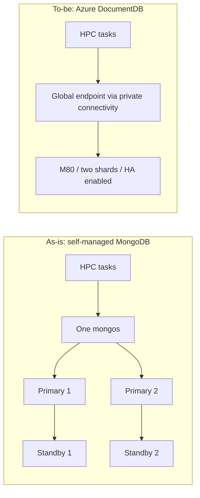

# From MongoDB to Azure DocumentDB: An HPC Workload Reference from Caldova Securities

A database supporting high-performance computing (HPC) can face relatively modest query volume and still experience severe connection pressure. When short-lived tasks repeatedly establish clients, negotiate TLS, authenticate, and disconnect, the connection lifecycle becomes a capacity requirement of its own.

Caldova Securities selected **Azure DocumentDB M80 with two shards and high availability (HA) enabled**, citing stability and performance. According to the client, its previous MongoDB deployment consisted of five components: two primaries, two standbys, and one `mongos` router.

This article describes the workload, the validation method, the configuration details that affected the tests, and the lessons another team can apply. Caldova Securities is a pseudonym. The final test campaign ran on 2026-08-03; some results come from earlier campaigns on 2026-08-02 and 2026-07-15, identified in Section 5. The measurements describe the tested database access pattern, not the performance of the HPC calculation engine or a quantified post-migration availability improvement.

## Key Takeaways

- At the production task rate (about 135 tasks/s, four operations per task, a new client per task), DocumentDB M80 with two shards and MongoDB with four routers both sustained the load. DocumentDB had the lower median latency; MongoDB had the tighter tail.
- Task rate and connection pressure are separate requirements. About 11,000 mostly idle connections is not 11,000 active workloads.
- Both targets reached 12,000 held connections, but that was the configured ceiling. M80 averaged 4,476 Ready connections versus 10,570 for MongoDB with four routers, and exceeded 10,000 in 2 of 3 iterations versus 3 of 3.
- The selected two-shard M80 was not tested at the production burst rate of about 1,210 connections/s. The overload results show saturation, not acceptable production behavior.
- No cost saving, availability improvement, or failover behavior was measured.

## 1. Translate the Existing Workload into Requirements

The database supplied calculation inputs and stored task results. A task followed this lifecycle:

```text
Create fresh client -> find input -> calculate -> delete previous output
                    -> insert result -> find result -> release resources
```

The four database operations were mandatory: two reads, one delete, and one insert. Replacing delete-plus-insert with an upsert would change the workload rather than reproduce it. Operations used the logical request identifier, `ReqId`.

The architecture change can be summarized as follows:



This is a logical diagram, not a complete replica-set or config-server deployment specification. The original one-router architecture must also be distinguished from the **two-router and four-router MongoDB configurations used in the benchmark**.

Production telemetry exposed two separate dimensions:

| Dimension | Requirement Used for Testing | What It Means |
|---|---|---|
| Task processing | Approximately 135 tasks/s, four database operations per task | Sustained processing of the calculation input/output cycle |
| Connection pressure | Bursts near 1,210 new connections/s; approximately 11,000 mostly idle live connections | Establishment and accumulation of connections, not 11,000 simultaneous active queries |

These peaks did not occur simultaneously. At the recorded connection peak, operation volume was only about five operations/s. Production also had multiple physical connections per logical task, including driver topology-monitoring connections. Task arrival rate and socket creation rate are therefore not interchangeable.

Connection lifetime explains why a low-operation workload can accumulate many connections. As an approximation, 1,210 new connections/s held for about nine seconds gives approximately 10,890 live connections. A throughput-only benchmark would miss this requirement.

## 2. Configure DocumentDB and the Access Path

The selected architecture was M80, two shards, and HA enabled. Record the storage allocation, region, network path, and HA state of your own campaign.

| | Azure DocumentDB | MongoDB, Four Routers |
|---|---|---|
| Compute | M80 per shard: 32 vCore / 128 GiB RAM, two shards | Two shard VMs (24 vCore each, also hosting `mongos`) plus two 8-vCore router VMs |
| Version and network | Managed service, private endpoint | MongoDB 7.0, private network, self-signed CA |
| Standby and failover | HA enabled; failover not tested | Standby behavior not tested |
| Load generators | One host (normal load); three hosts (hold and overload) | Same |

The other DocumentDB tiers tested were M60 (16 vCore / 64 GiB per shard) and M200 (64 vCore / 256 GiB per shard); see [Microsoft Learn](https://learn.microsoft.com/en-us/azure/documentdb/compute-storage) for tier sizes.

### Endpoint, Networking, and Authentication

Use the service-provided global endpoint with SRV discovery, without pinning to a specific backend host. A sanitized URI shape is:

```text
mongodb+srv://<user>:<encoded-password>@<cluster>.global.mongocluster.cosmos.azure.com/<database>?tls=true&authMechanism=SCRAM-SHA-256&retrywrites=true
```

Start with the connection string supplied by the service and retain its required options. The example above illustrates the endpoint and authentication choices; it is not a replacement for a cluster-specific connection string.

The reference environment used private connectivity. Each generator VNet needed connectivity to the private endpoint and the appropriate link to `privatelink.mongocluster.cosmos.azure.com`. Verify both the seed hostname and the SRV target hostnames resolve privately, then verify TCP reachability. Do not hard-code a resolved backend IP into the application.

The `.global` hostname is an access-path detail, not evidence that cross-region disaster recovery has been configured or tested.

### Data Distribution and Driver Settings

| Setting | Reference Behavior |
|---|---|
| Dataset | 100,000 input documents generated with seed 42 |
| Document sizes | 6 KiB: 10,000; 16 KiB: 15,000; 50 KiB: 35,000; 58 KiB: 40,000 |
| Operation key | Indexed `ReqId` in input and output collections |
| Distributed shard key | Hashed `ReqId` in the two-shard test |
| Software | .NET 8 and MongoDB C# driver 2.30 |
| Per-task client | New client and settings; `maxPoolSize=1`, `minPoolSize=0`; no cross-task reuse |
| Timeouts | Server selection and connect: 5,000 ms each; no socket timeout |
| Retryable writes | Forced on for DocumentDB by the benchmark factory |

Provisioned shards were not sufficient evidence of distribution. Earlier runs described as single-shard had data concentrated on one shard, even where two physical shards were provisioned. For the distributed tests, the collection was sharded while empty and then reseeded; distribution was checked using chunk metadata and query explain output. Treat that as the procedure used in this case, not a claim that every existing dataset must be rebuilt.

Configuration files inherit through `Extends`, and code can override URI settings; the final DocumentDB client forces retryable writes on regardless of the URI. Reproduction requires the **effective configuration**, not just the connection string.

## 3. Keep the Generator from Becoming the Bottleneck

Connection churn exercises the client host as well as the database. These generator details are not DocumentDB-specific, so they are summarized here; the repository holds the full detail.

### TCP Capacity and Arrival Budgets

Windows generators were tuned to a dynamic TCP port range of **10000-65534** with **`TcpTimedWaitDelay=30 s`**, applied on every generator, followed by reboot and verification.

Dividing 55,535 ports by 30 seconds gives a TIME_WAIT-only budget of about **1,851 connections/s per host**. This is a sizing estimate, not guaranteed throughput; CPU and handles also matter.

The three-host overload configuration used four Poisson job arrivals/s per host and 150-500 tasks/job, an expected offered rate of about 1,300 tasks/s per host (3,900 combined), below that budget. The inherited multi-host base (six jobs/s, about 1,950 tasks/s per host) would have exceeded it.

Configured offered rate is not measured connection rate. Inspect arrival counters, connection attempts, Ready events, and completions separately.

Use [the committed TCP tuning script](../scripts/setup/tune-vm1.ps1) on dedicated test hosts with appropriate privileges. OS networking changes require review and should not be applied indiscriminately to production machines.

### Client Runtime and Lifecycle Controls

| Failure Risk | What the Benchmark Did | Production Implication |
|---|---|---|
| Slow failures accumulating | Applied 5-second connect and server-selection timeouts | Add whole-task deadlines and bounded retry budgets; connection timeouts do not bound every operation |
| ThreadPool starvation | Set `ThreadPool.SetMinThreads(512, 512)` after a sustained-load incident (idle database, rising client latency) | Measure queueing, threads, CPU, and handles first; 512 is not a universal recommendation |
| Topology-monitor growth | Round-robin pinned self-managed tasks to one router with `directConnection=true` | A benchmark access-path optimization for MongoDB, not a general-purpose HA discovery pattern; DocumentDB used its global endpoint unpinned |
| Cluster resources outliving tasks | Explicitly unregistered and disposed each cluster | Uses a driver-internal API; pin the driver and retest cleanup on upgrades |

The driver still created an internal pool object; the constraint was **no reuse between tasks**. The benchmark's teardown and lifecycle events were part of the test contract.

### TLS Settings Must Be Disclosed

The implementation records concurrent certificate-revocation checks causing handshakes around 29.5 seconds at 40-way concurrency, compared with under 100 ms sequentially. The factory disabled revocation checks through `CheckCertificateRevocation=false`.

Separately, the self-managed MongoDB normal-load and hold configurations enabled `MongoAllowInsecureTls`, relaxing certificate validation for private-CA routers. These are different security changes: disabling revocation checks is not the same as bypassing chain/hostname validation.

Both affect comparison conditions. Neither should be silently copied into production. Use trusted certificates, plan certificate and revocation-path connectivity, and obtain security review. Managed-target chain/hostname validation was retained, but revocation checking was still disabled in the benchmark.

### Server Limits, Backpressure, and Recovery

On self-managed MongoDB, raising a connection limit only removes a configured ceiling; it does not create TLS/authentication CPU capacity. The two-router configuration saturated VM CPU while four routers did not (Section 5).

Open-loop tests intentionally bypassed `MaxConcurrentTasks`. They exposed accumulation when the backend slowed, but were not overload-safe application designs. For production, use bounded queues/concurrency, rate limits, backpressure, and retries that cannot amplify a failing dependency. Enable only one arrival scenario unless combined traffic is explicitly intended.

Between tests, verify Ready connections and outstanding work drain, CPU recovers, and TIME_WAIT pressure falls. The benchmark used a TIME_WAIT count below roughly 200 as the readiness check. A recorded M200 throttling episode recovered after approximately eight minutes; that was an observation, not a documented cooldown guarantee.

## 4. Run Separate Tests for Separate Questions

The benchmark used the same deterministic dataset and operation semantics across targets, with untimed data-cache warm-up. Connections remained fresh during measurement: **warm data did not mean warm reusable connections**.

| Scenario | Model | Question |
|---|---|---|
| Normal processing | Closed-loop full four-operation workload, approximately 135 tasks/s | Can the platform process the task workload at stable latency? |
| Production-rate connection pressure | Two-host open-loop campaign near 1,210 connections/s | How do connections accumulate at the production-shaped rate? |
| Deliberate overload | Three-host open-loop configuration, expected offered rate near 3,900 tasks/s | Where do backlog, latency, and failures emerge? |
| Connection holding | Three hosts, 4,000 gated tasks/host, 12,000 combined ceiling | How many established connections can be held? |
| Operation baseline | One indexed find or insert per fresh client | What is the isolated operation latency at non-saturating load? |

The normal-load final comparison used a single generator, three 300-second iterations, and no calculation sleep, so each connection lived for milliseconds rather than production's roughly nine seconds. The overload configuration used a 2,900 ms task wait. The three-host hold test used a 300-second window and a keepalive input read every 10 seconds per held connection. The production-rate campaign was earlier, with different timing and code history. Record these differences rather than describing all tests as one identical experiment.

Two fidelity limits apply:

- **Hold:** at a full 12,000 connections, the keepalive schedule can offer about 1,200 reads/s, against production's roughly five operations/s at its connection peak. It approximates connection holding, not production load.
- **Open-loop:** every connection ran the full four-operation cycle, whereas production's additional connections were mostly driver monitoring with almost no operations. Database work at the connection peak is overstated.

The benchmark defined no pass/fail thresholds. Before sizing production, agree acceptance criteria: an error-rate limit, a p99 within the task deadline, a connection population sustained for the full window, and recovery to baseline after overload.

Targets ran sequentially. Later multi-host campaigns used the same generator pool for both targets, with a shared start time for each iteration. The coordinator waited for all hosts, including drain, and the merge required the complete host set. Missing hosts or incompatible iterations were not valid combined results.

### A Minimal Reproduction Workflow

1. Provision private connectivity and record target/generator topology, VM sizes, software revision, and effective settings.
2. Set connection secrets outside the repository, tune each generator, and verify DNS/TCP connectivity.
3. Seed data, create indexes, and verify physical distribution.
4. Run preflight and untimed warm-up before each measured iteration.
5. Execute one scenario against one target at a time; synchronize multi-host iterations.
6. Drain and clean output, merge matching host artifacts, and retain raw metrics plus resource telemetry.

For example, these repository commands prepare and run the single-host normal-load scenario against DocumentDB:

```powershell
dotnet build Bmt.sln -c Release
dotnet run --project src/Bmt.Seeder -- prepare-data --config config/production/full-workload-closed-loop-steady.json --target documentdb
dotnet run --project src/Bmt.Preflight -- preflight --config config/production/full-workload-closed-loop-steady.json --target documentdb --warmup
dotnet run --project src/Bmt.LoadGen -- test --config config/production/full-workload-closed-loop-steady.json --target documentdb --scenario steady
dotnet run --project src/Bmt.Seeder -- clean-output --config config/production/full-workload-closed-loop-steady.json --target documentdb
```

Use the [multi-host runbook](../scripts/run/README.md) for synchronization and merge requirements, adapting infrastructure identifiers to your own environment. Do not launch an ungated overload scenario merely to verify connectivity; start with smoke configurations.

## 5. Read the Results Without Combining Different Claims

The following values are taken from the [consolidated report](../results/REPORT-mongo-vs-documentdb-churn-benchmark.md). Reported percentile summaries follow the campaign's host/iteration aggregation; an average of p99 values is not a pooled global p99. Combined connection concurrency is the peak of the synchronized per-second sum of driver `ActiveReady`, not the sum of unrelated host peaks.

| Result | Campaign | Date | Notes |
|---|---|---|---|
| Normal load (both targets) | `run-20260803-02` | 2026-08-03 | One host, 3 x 300 s, MongoDB with relaxed TLS |
| DocumentDB M80 hold and overload | `run-20260802-01` | 2026-08-02 | Three hosts |
| MongoDB four-router hold and overload | `run-20260727-*` / `run-20260731-01` | Late July 2026 | Three hosts, relaxed TLS |
| Production-rate run | `run-20260715-2host-openloop` | 2026-07-15 | One-shard M80, older code |

### Normal Task Processing

The final-code, single-host comparison used three 300-second iterations:

| Metric | DocumentDB M80, Two Shards | MongoDB, Four Routers |
|---|---|---|
| Task throughput | 134.9 tasks/s | 134.9 tasks/s |
| Reported error rate | 0.000% | 0.001% |
| Input find p50 / p90 / p99 | 27.5 / 59.3 / 107.8 ms | 45.6 / 51.7 / 67.9 ms |
| Insert p99 | 41.1 ms | 7.4 ms |
| Connection-open p99 | 75.6 ms | 37.0 ms |

Both configurations sustained the processing target. DocumentDB had the lower median input-read latency; MongoDB had tighter tails. This is a latency-distribution tradeoff, not a throughput victory. The MongoDB comparison used the disclosed TLS relaxation, so it is not a security-identical engine comparison.

### Connection Holding

| Metric | DocumentDB M80, Two Shards | MongoDB, Four Routers |
|---|---|---|
| Best-iteration peak Ready connections | 12,000 | 12,000 |
| Reported average Ready connections | 4,476 | 10,570 |
| Iterations exceeding 10,000 | 2 of 3 | 3 of 3 |
| Keepalive find p99 | 23.271 s | 14.803 s |
| Connection attempts / failures | 49,885 / 88 | 38,991 / 2,377 |

Reaching 12,000 once is not the same as holding 12,000 continuously or doing so reliably in every iteration. Because 12,000 equals the configured gate (3 x 4,000), it shows the ceiling was reached, not where capacity ends. M80's best peak provides evidence of achievable connection population, while its average and iteration results qualify the headroom claim. Establishment latency was not captured in the two-shard hold compacts, so a common cross-target establishment comparison cannot be made from that table.

The two-router MongoDB configuration peaked near 4,714 held connections and showed about 99.7% VM CPU. Four routers reduced reported per-router CPU to approximately 17-21%. Router placement and handshake CPU mattered independently of shard count.

### Deliberate Overload and Production-Rate Pressure

Under the three-host overload scenario, M80 two-shard DocumentDB reported 72.9 tasks/s, connection-open p99 of 22.340 seconds, and an 89.1% error rate. MongoDB four-router reported 71.2 tasks/s, connection-open p99 of 159.686 seconds, and a 94.9% error rate. These are **saturation results**, not acceptable production error rates.

DocumentDB server CPU remained near idle in the retained churn/hold telemetry. Establishment failures and queueing were consistent with an admission-layer constraint rather than shard compute saturation. That is an interpretation of observed metrics, not direct measurement of internal gateway capacity; client ThreadPool, DNS, TLS, and cleanup issues must first be excluded.

The earlier production-rate run (2026-07-15) used M80 with data on one shard and reached 9,979 connections with a 38.8% error rate. It did not prove clean admission of 11,000 connections, and the selected two-shard M80 was not tested at that rate. Its older MongoDB counterpart also predates TLS/lifecycle changes and is not a current like-for-like comparison. Database CPU telemetry was not retained for that campaign.

Single-operation tests provided a useful non-saturating reference, but used different historical durations and reported iterations 2-3 rather than all three. They must not substitute for full-workload results or be mixed into a single performance score.

### Business Value and the Selection Decision

Caldova chose M80 two-shard DocumentDB with HA for stability and performance. The tests showed normal processing capacity, characterized connection-pressure behavior, and identified client and server settings that mattered for replication. The managed operating model also offers a path to reducing responsibility for a self-managed router/database fleet.

That expected operational benefit is separate from measured performance. The records do not quantify cost savings, post-migration incident reduction, long-term availability, or zero-downtime failover. Nor do they establish that M80 two-shard is universally optimal: other tiers differed under churn, and the M200 two-shard overload runs included intermittent admission throttling.

## 6. Lessons to Apply to Another Workload

**Reuse clients where semantics allow.** Connection pools avoid repeated TCP, TLS, and authentication work. This benchmark deliberately prohibited cross-task reuse to reproduce a constrained lifecycle, so its results are a worst case, not an application design to copy.

**Shard for distribution, not simply for more connections.** Add shards when data/storage growth or sustained operation load requires distribution, using a shard key that matches the workload, and verify actual placement. In these tests, data on two shards raised the hold ceiling (one shard plateaued near 11,000 held connections, with keepalive p99 of 114-139 s versus 23-34 s on two shards), but sharding did not fix churn throughput, where compute tier mattered more.

**Use HA for availability, not throughput.** HA addresses availability and failover; the standby is not an additional readable scale-out shard. A zero-downtime objective requires failover tests covering driver reconnection, retryable operations, application error handling, and interrupted work. HA enabled is not proof of uninterrupted requests, and these churn tests did not validate failover.

**Use the service endpoint and validate discovery.** Preserve the service-provided global endpoint and private DNS reachability, without pinning to a backend host. This keeps failover and endpoint changes transparent to the application; validate them with a failover test rather than assuming them.

**Scale the layer that is under pressure.** More shard compute will not automatically fix a generator thread queue, a router performing TLS/authentication, or an admission bottleneck. Observe those layers before changing tier or shard count. At normal load, higher DocumentDB tiers did not consistently lower indexed-operation latency.

**Bound overload and test recovery.** Select latency, error, sustained-capacity, and recovery acceptance criteria before sizing production. Apply deadlines, bounded work queues, backpressure, and retry budgets. Measure how the system recovers after overload, not only its highest connection peak.

## 7. Production Readiness and Open Gaps

Checklist before adopting a configuration:

- Reuse clients or pools; set whole-task deadlines, retry budgets, and backoff.
- Run a failover test and an overload-recovery test.
- Monitor client `ActiveReady` and TIME_WAIT, plus DocumentDB CPU and throttling signals.
- Review the error taxonomy for compatibility errors before drawing performance conclusions.
- Check the [official DocumentDB limits](https://learn.microsoft.com/en-us/azure/documentdb/compute-storage) for your tier. M200 showed intermittent admission throttling under sustained churn, recovering after about eight minutes; that is an observation, not a guarantee.

Gaps this benchmark leaves open:

- Two-shard M80 at the production burst rate of about 1,210 connections/s.
- A pooled-client baseline for the same workload.
- A failover run covering reconnection and interrupted work.

## Conclusion

The transferable reference is the method: derive processing and connection requirements separately, reproduce the relevant lifecycle, validate generator headroom, and interpret latency, failures, and sustained capacity together. Caldova's selected architecture is one outcome of that process, not a substitute for running it against another application's requirements.

## Reference Material

- [Private endpoint procedure](../infra/documentdb-private-endpoint/README.md)
- [Benchmark CLI and project structure](../README.md), [production configuration guide](../config/production/README.md), and [multi-host execution runbook](../scripts/run/README.md)
- [TCP tuning](../scripts/setup/tune-vm1.ps1) and [base client configuration](../config/production/base.json)
- [Effective client settings](../src/Bmt.Core/Connections/TaskConnectionFactory.cs), [cluster teardown](../src/Bmt.Core/Connections/MongoClientReleaser.cs), and [ThreadPool configuration](../src/Bmt.LoadGen/Program.cs)
- [Consolidated results and campaign provenance](../results/REPORT-mongo-vs-documentdb-churn-benchmark.md) and [metric definitions](../docs/metrics-reference.md)